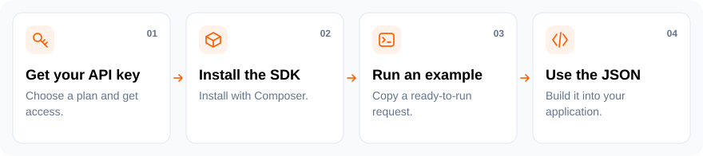

# Instagram Scraper API for PHP

[](https://github.com/jsonscraper/instagram-api-php/tags)
[](#quick-start)
[](https://github.com/jsonscraper/instagram-api-php/commits)
[](LICENSE)
[](https://packagist.org/packages/jsonscraper/instagram-api-php)
[](https://packagist.org/packages/jsonscraper/instagram-api-php)
[](https://www.postman.com/jsonscraper/workspace/jsonscraper/collection/52903714-fe84d353-0a19-431f-a39d-1c2640d96fb0)

Composer client with **LazyJsonMapper response models** and ready-to-run examples. Supports **97 Instagram Scraper API methods**.

**Package:** `jsonscraper/instagram-api-php` · **[Methods](#main-methods)** · **[Examples](#ready-to-run-examples)** · **[Documentation](docs/guide.md)**



## Quick start

**1. Get your key** from the [Instagram API product page](https://jsonscraper.com/services/ig-scraper-api?utm_source=github&utm_medium=sdk&utm_campaign=instagram-api-php&utm_content=readme) and set it on your server:

```sh
export JSONSCRAPER_INSTAGRAM_LICENSE_KEY='your-license-key'
```

**2. Install the package:**

```sh
composer require jsonscraper/instagram-api-php:^0.1
```

**3. Make a request:**

```php
<?php
require __DIR__.'/vendor/autoload.php';

$client = new JsonScraper\Instagram(getenv('JSONSCRAPER_INSTAGRAM_LICENSE_KEY'), models: true);
$response = $client->v1_user_by_username(['username'=>'apple', 'cache_timeout'=>60]);
if ($response->isOk() && $response->getIg()) {
    echo $response->getIg()->getUsername();
}
```

The API payload is in `ig`. Live calls require a valid API license and may consume quota. [Response examples and status handling](docs/responses.md).

## Main methods

97 methods are available. Common starting points:

| What you need | Method |
| --- | --- |
| Read a profile | `v1_user_by_username()` |
| Read a profile by ID | `v1_user_by_id()` |
| List profile posts | `v1_user_medias_chunk()` |
| Read a post or reel | `v1_media_by_code()` |
| Read comments | `v1_media_comments_chunk()` |
| Search profiles | `v1_search_users()` |

[All methods and parameters →](docs/endpoints.md)

## Ready-to-run examples

- [Read a profile](examples/endpoints/v1_user_by_username.php).
- [Read a post or reel](examples/endpoints/v1_media_by_code.php).
- [Read comments](examples/endpoints/v1_media_comments_chunk.php).
- [Search users](examples/endpoints/v1_search_users.php).
- [List profile posts](examples/endpoints/v1_user_medias_chunk.php).

Each example includes command-line parameters, key setup, timeouts, error handling and response output. Run it with `--help` first; this makes no API request.

**[Browse all 97 complete examples](examples/README.md)** · **[Full method and parameter reference](docs/endpoints.md)**

## Response models

Use `models: true` for **LazyJsonMapper** objects such as `Profile`, `Media`, `Comment` and `Collection`. Use the default array mode for the full upstream envelope.

```php
$profile = $response->getIg();
echo $profile->getUsername();
echo $profile->getFollowerCount();
```

[Model hierarchy, media and collection examples](docs/models.md) · [All model classes](src/Response/Model)

## Configuration

Requests use a 30-second timeout by default. Configure caching and retries to fit your application's request budget. Keys are read from your server environment; redirects are disabled.

[Configuration options, HTTP errors, caching and pagination](docs/configuration.md) · [Full integration guide](docs/guide.md)

## Access, pricing and support

The SDK source is **MIT-licensed**. Hosted API access requires a separate Instagram license. Check [current plans and get access](https://jsonscraper.com/services/ig-scraper-api?utm_source=github&utm_medium=sdk&utm_campaign=instagram-api-php&utm_content=readme).

[Service support](https://jsonscraper.com/contacts?utm_source=github&utm_medium=sdk&utm_campaign=instagram-api-php&utm_content=support) · [SDK issues](https://github.com/jsonscraper/instagram-api-php/issues) · [Changelog](CHANGELOG.md) · [MIT license](LICENSE)

## Development

```sh
python3 tests/contract.py
```

Tests use a local/mock server and require no API key. A [GitHub Actions template](docs/github-actions.yml) is available for optional automation.

The SDK has no installation or usage telemetry. README links use campaign parameters for website referral analytics. jsonscraper is independent and is not affiliated with Instagram or Meta.
